# Laporan PKL — Pembuatan Undangan Pernikahan Digital
### Yanti & Huda — Tema "Serenade Maroon"

---

## 1. Pendahuluan

Laporan ini mendokumentasikan hasil kerja pembuatan undangan pernikahan digital berbasis web. Undangan dibangun menggunakan **HTML, CSS, dan JavaScript** dalam satu berkas (`index.html`), tanpa framework, sehingga ringan dan mudah di-hosting (GitHub Pages).

---

## 2. Hasil Screenshot Undangan

### Cover / Sampul

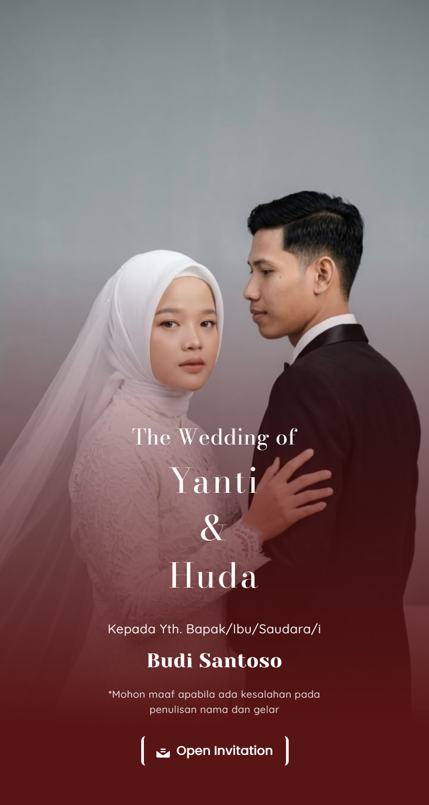

### Hero & Countdown

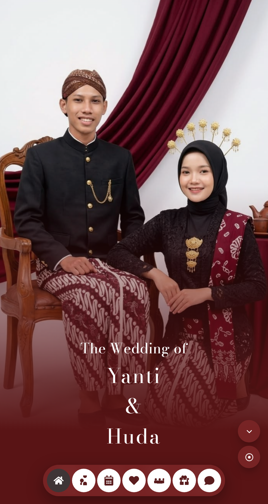

### Ayat & Salam

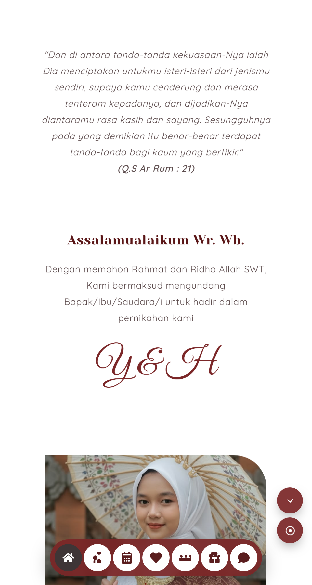

### Profil Mempelai

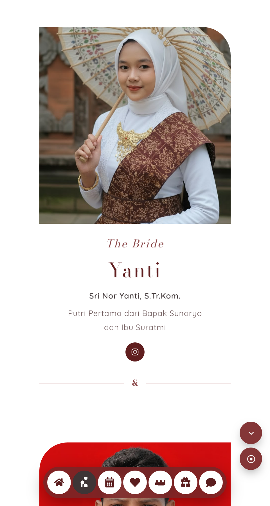
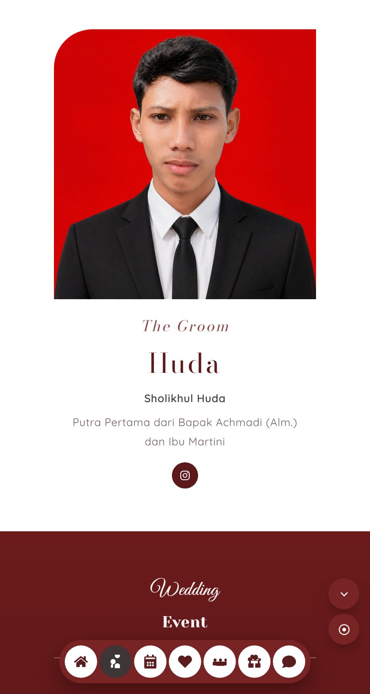

### Event (Akad & Resepsi)

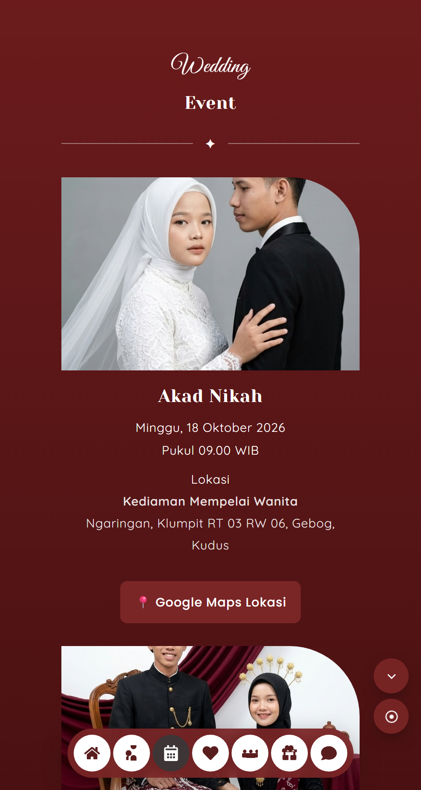

### Story Timeline

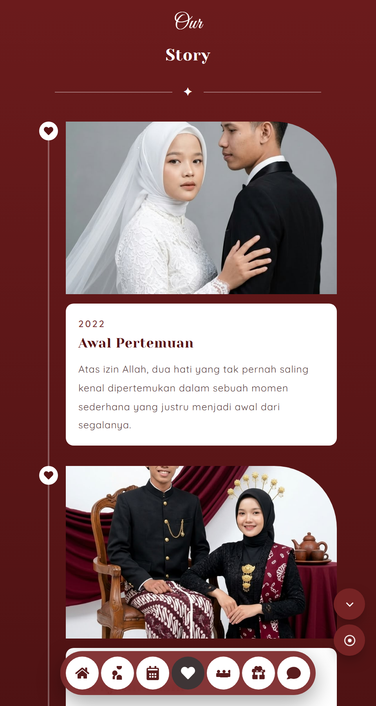

### Gallery & Lightbox

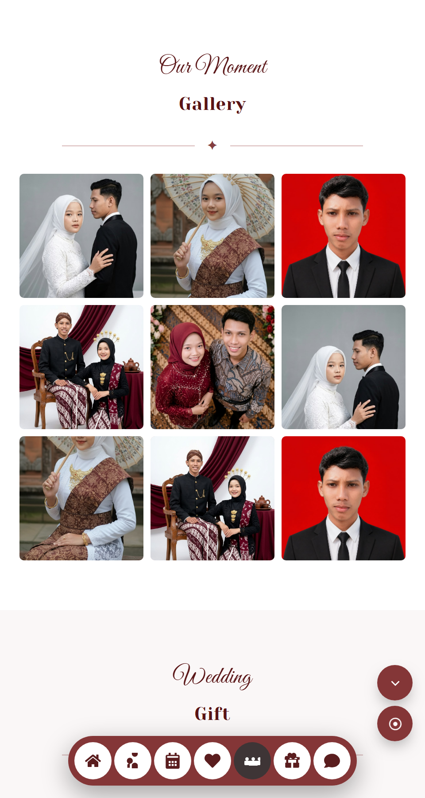
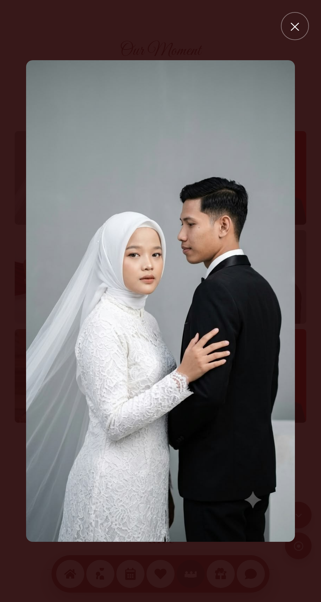

### Gift (Hadiah)

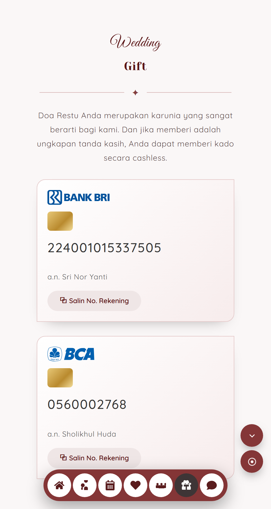

### Wishes (Ucapan & Doa)

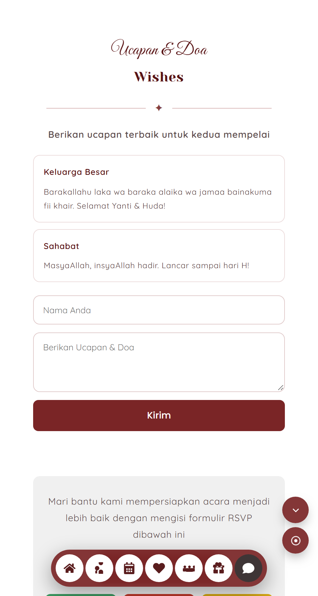

### RSVP (Konfirmasi Kehadiran)

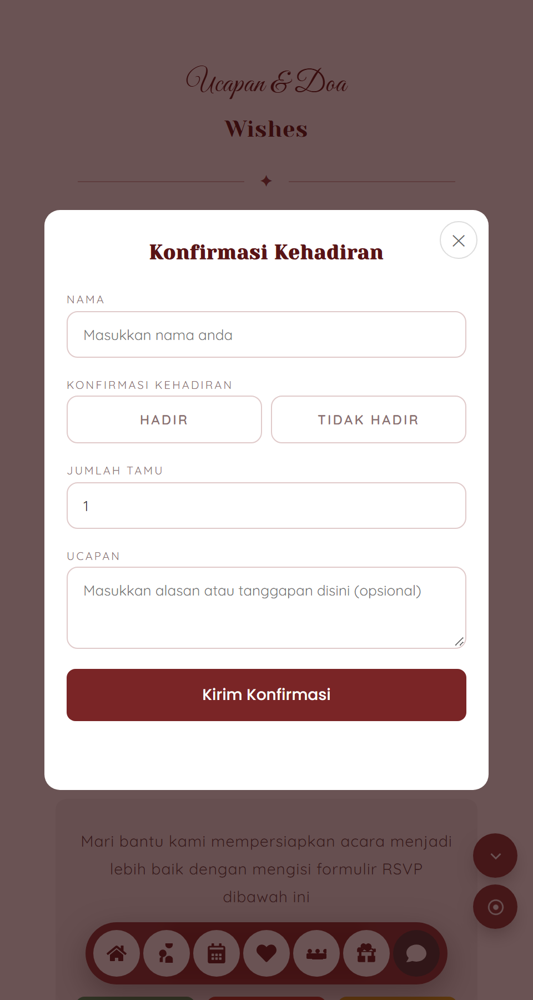
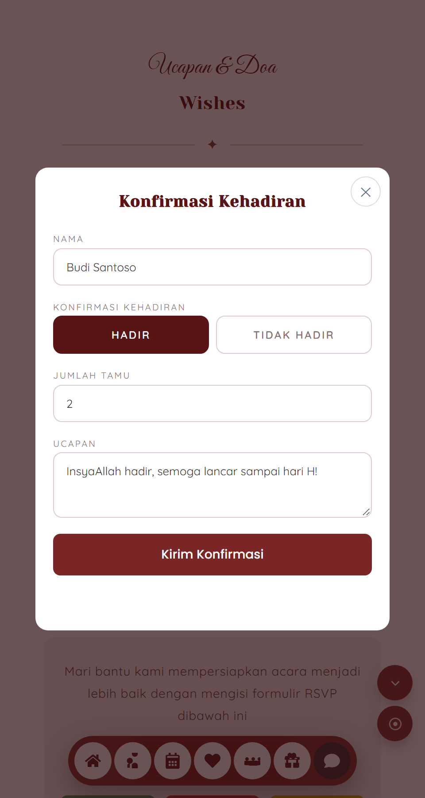
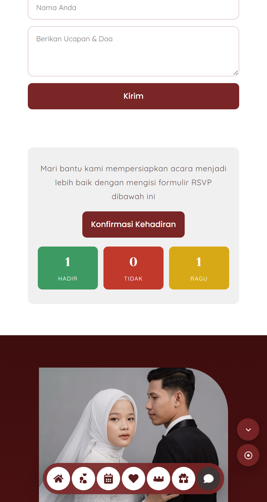

### Navigasi & Tombol Mengambang

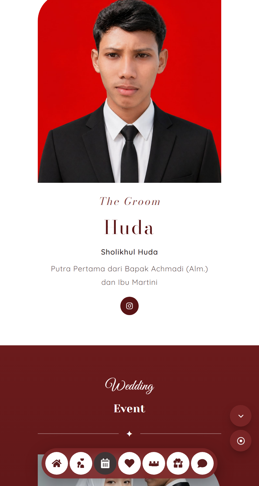

### Penutup

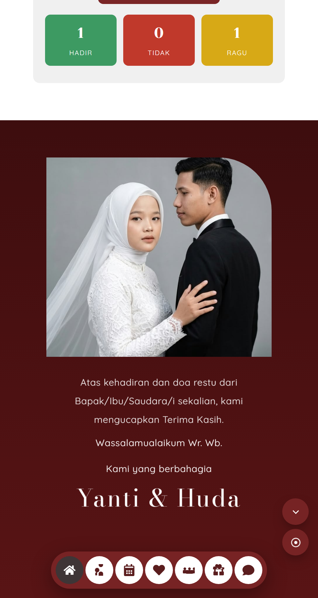

---

## 3. Penjelasan Hasil Undangan Secara Keseluruhan

Pada seluruh screenshot di atas, menampilkan hasil pembuatan undangan pernikahan digital bertema **"Serenade Maroon"** dengan warna dasar maroon dan desain elegan yang berjalan di perangkat mobile. Undangan dibuka melalui **sampul** berupa foto prewedding full-screen dengan nama tamu yang bersifat personal (dapat diisi melalui URL), dan jika tombol "Open Invitation" diklik maka sampul akan menutup, halaman utama terbuka, serta musik latar otomatis diputar.

Masuk ke halaman utama, terdapat foto hero kedua mempelai lengkap dengan **countdown hitung mundur** menuju hari pernikahan dan tombol "Save to Calendar" untuk menyimpan jadwal ke Google Calendar. Selanjutnya ditampilkan **ayat Al-Qur'an (Q.S Ar-Rum: 21)**, salam pembuka, serta **profil kedua mempelai** (The Bride & The Groom) yang memuat foto, nama lengkap, nama orang tua, dan tombol Instagram masing-masing.

Undangan dilanjutkan dengan bagian **Event** yang menampilkan jadwal Akad Nikah dan Resepsi lengkap dengan tanggal, jam, alamat, dan tombol Google Maps untuk membantu tamu menemukan lokasi acara. Kemudian terdapat **Story Timeline** berisi tiga tahap perjalanan hubungan mempelai (Awal Pertemuan, Menjalin Kasih, Menuju Pernikahan), **Galeri foto** 9 foto yang jika diklik akan tampil besar melalui lightbox, serta bagian **Gift** berupa kartu ATM digital BRI dan BCA dengan tombol salin rekening, alamat pengiriman kado, dan tombol WhatsApp.

Pada bagian akhir, terdapat fitur **Wishes** untuk mengirim ucapan dan doa yang tersimpan menjadi dinding ucapan, serta fitur **RSVP** berupa modal konfirmasi kehadiran (Hadir / Tidak Hadir) dengan jumlah tamu, yang datanya otomatis terhitung pada tiga counter berwarna hijau (Hadir), merah (Tidak), dan kuning (Ragu) agar mempelai dapat memantau perkiraan jumlah tamu. Seluruh halaman diakses melalui **navigasi pill di bagian bawah layar** yang tersorot otomatis sesuai seksi yang sedang dilihat, dilengkapi tombol lanjut ke seksi berikutnya dan tombol kontrol musik di pojok kanan. Undangan ditutup dengan **bagian penutup** berisi ucapan terima kasih dan nama kedua mempelai.

---

## 4. Teknologi yang Digunakan

| Komponen | Keterangan |
|----------|------------|
| HTML5 | Struktur halaman |
| CSS3 | Tampilan, animasi reveal, efek Ken Burns, responsif mobile |
| JavaScript | Countdown, render dinamis, localStorage (ucapan/RSVP), lightbox, navigasi |
| Google Fonts | Bodoni Moda, Yeseva One, Great Vibes, Quicksand, Poppins |
| GitHub Pages | Hosting undangan |

---

## 5. Kesimpulan

Undangan pernikahan digital berhasil dibuat dengan tampilan elegan bertema maroon dan memenuhi kebutuhan undangan pernikahan modern: personalisasi nama tamu, informasi acara lengkap dengan peta, galeri, gift, ucapan, dan RSVP. Seluruh fitur berjalan tanpa server/backend sehingga mudah dipelihara dan di-hosting.

---

*Laporan dokumentasi hasil pembuatan undangan — Yanti & Huda.*
